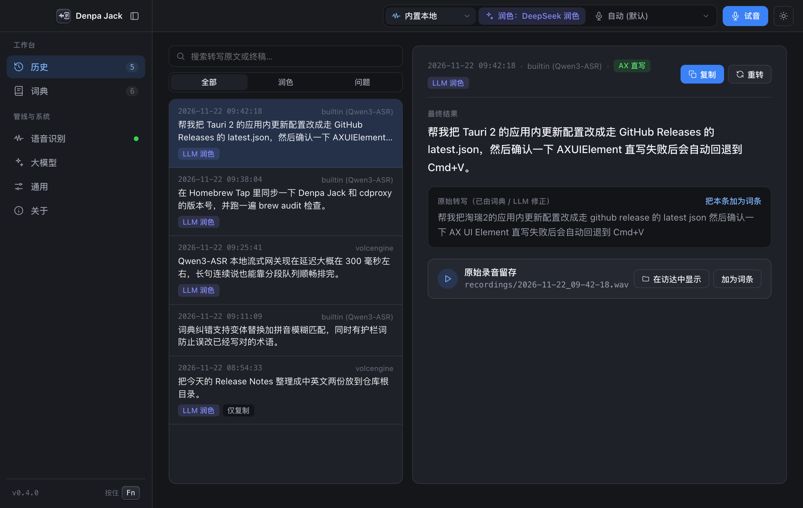
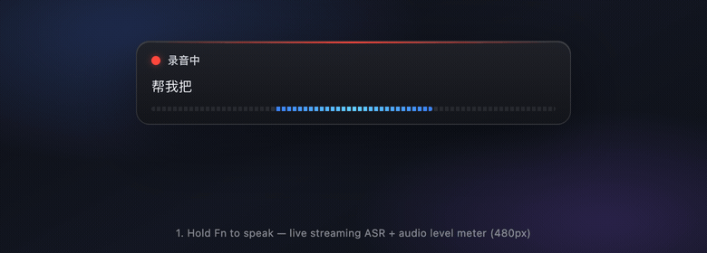
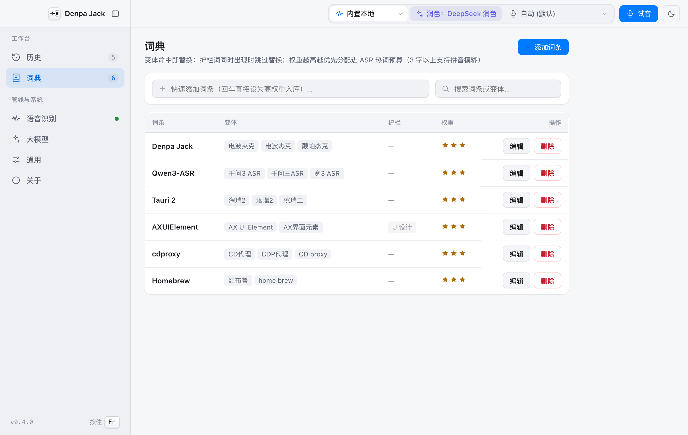

# Denpa Jack

[English](README.md) | [中文](README.zh.md)

Denpa Jack 是未来道具研究所（Mirai Gadget Kenkyujo）的**未来道具 14 号机：电波劫持者**
（未来ガジェット14号機：電波ジャック / *Mirai Gajetto Jūyon-gōki: Denpa Jakku*）。
原作里它把录下的声音强制放送到秋叶原的每一块屏幕上；这个项目做其中真正有用的那一半——
**按下热键、说话，把文字强制送进你当前的光标位置**：语音转写 → 词典纠错 →（可选）LLM 润色
→ 经辅助功能接口直写，或回退 `Cmd+V` 粘贴。

macOS 菜单栏常驻（不占 Dock）。录音时浮窗显示实时转写文本与音量条。

<p align="center">
  
</p>

## 悬浮录音 HUD 与亮色外观

按住热键说话时，悬浮录音窗实时展示流式转写与声纹音量条；连续多句排队时平滑展开为双栏队列（`480px → 664px`），经词典纠错与 LLM 润色后自动上屏并收起：

<p align="center">
  
</p>

<details>
<summary>更多截图（亮色主题 · 词典与热词权重管理）</summary>

<p align="center">
  
</p>

</details>

## 核心特性

- **全局快捷键**：支持 `Fn`、纯修饰键组合（如 `ctrl+option`）、字母/数字/F1–F12；
  两种触发模式（按住说话 / 短按开始再短按结束）；设置页内可视化录制
- **ASR 引擎**：内置本地流式网关（`denpa-asr`，Qwen3-ASR / MLX）/ 豆包流式 2.0
  （WebSocket 二进制协议，热词直传，实时 partial）/ 智谱 GLM-ASR（文件式，失败兜底）
- **词典纠错**（不依赖大模型）：变体替换 + 正则规范化 + **拼音模糊匹配**
  （近音音节按 0.5 代价、仅 3 字以上生效），三层护栏防误替换
- **LLM 润色**：多档案管理、**工具调用强制结构化回传**（不返回纯文本）、
  思考链开关与思考强度可选、prompt 可编辑（含 Markdown 预览）
- **截图作为纠错上下文**（默认关闭）：开始录音时截取活动窗口/屏幕送入大模型辅助识别专有名词；
  需授予「屏幕录制」权限，截图归档于 `screen_context/`，失败自动降级纯文本纠错
- **交付**：优先 AX 直写目标应用，失败回退 `Cmd+V`；剪贴板可配置为
  「保留转写」或「用后恢复」
- **历史**：JSONL 记录 + 音频留存（可播放 / 重新转写 / 复制 / 在访达中显示），按上限自动裁剪
- **麦克风**：设备优先级、热插拔**事件驱动**刷新（不做轮询）、当前设备实时显示
- **应用内更新**：检查发布通道 `latest.json`，内置 minisign 强校验下载并原地替换，
  无浏览器隔离标记（quarantine），升级后无需重授麦克风与辅助功能权限

## 工作流程

```
热键 ──► cpal 采集（原生格式 → 单声道 → 16 kHz，200 ms 分块）
    ──► ASR 引擎（partial 实时推给浮窗）
    ──► 松开：收尾帧 + 等服务端最终结果
    ──► 词典（规范化 → 变体替换 → 拼音模糊）
    ──► 可选 LLM 润色（工具调用；失败降级为词典结果）
    ──► 交付：AX 直写 → 回退 Cmd+V（按下时锁定目标应用）
    ──► 剪贴板 + 历史（+ 音频文件，按上限裁剪）
```

## 安装

### Homebrew（macOS Apple Silicon）

```bash
brew tap yangyaofei/tap
brew install --cask denpa-jack
```

后续可通过 `brew upgrade --cask denpa-jack` 或应用内更新升级（签名身份固定，升级不丢麦克风与辅助功能授权）。

### GitHub Releases

从 [GitHub Releases](https://github.com/yangyaofei/denpa-jack/releases) 下载 `Denpa.Jack_<版本>_aarch64.dmg`（或 `.app.zip`），将 `Denpa Jack.app` 拖入「应用程序」。

## 构建

```bash
npm install
npm run tauri dev          # 开发
```

打包（macOS）：

```bash
npm run tauri build
# 直接用证书文件签名（不需要钥匙串、不需要系统信任）
~/.local/bin/rcodesign sign \
  --p12-file "certs/denpa-jack-dev-10y.p12" \
  --p12-password-file "certs/denpa-jack-dev-10y.pw" \
  "src-tauri/target/release/bundle/macos/Denpa Jack.app"
```

首次构建需联网：键盘层用的是固定在指定 commit 的**打过补丁的 `handy-keys`**——
补丁说明见 [src-tauri/Cargo.toml](src-tauri/Cargo.toml) 的 `[patch.crates-io]` 注释。

## 签名与权限

签名用 [rcodesign](https://github.com/indygreg/apple-platform-rs) **直接读 `.p12` 文件**完成：
证书不必导入钥匙串，也不必让系统信任它。`codesign` 做不到这一点——用未信任的自签证书时它
直接拒绝签名（`CSSMERR_TP_NOT_TRUSTED` / `no identity found`）；而 rcodesign 产出的是标准
签名，`codesign --verify` 能通过，TCC 权限也正常工作（本机已端到端验证）。

- Bundle id 固定为 `io.github.yangyaofei.denpajack`；证书是本机自签的 `Denpa Jack Dev`
  （10 年），放在仓库内的 `certs/` 目录（该目录已 gitignore，不会入库）。
  这两样都不要变：macOS 的 TCC 按**代码要求**（identifier + 证书叶指纹）记录权限，
  换 bundle id 或换证书都会导致麦克风 / 辅助功能需要重新授权。
- **在别人的 Mac 上**：本地拷贝（U 盘、`scp`）能直接跑，但权限要在那台机器授权；
  带隔离标记的拷贝（AirDrop、浏览器、邮件）会被 Gatekeeper 拦截，需要
  *系统设置 → 隐私与安全性 → 仍要打开*（`xattr -dr com.apple.quarantine` 同样有效）。
  想让别人下载就能跑，只有 **Developer ID + 公证**一条路。
- CI/CD：rcodesign 也能在 Linux runner 上跑，配合 App Store Connect API Key 还能公证。

完整说明、实测证据与排障见 [docs/CI-CD.md](docs/CI-CD.md)。

## 测试

```bash
cd src-tauri && cargo test --lib      # 单元测试（151 项）
npx tsc --noEmit && npm run build && node tests/frontend-checks.mjs
./scripts/regression.sh               # 回归闸门：单测 → 文件回放 → UI 数据链 → e2e → 打包签名
```

自测模式（环境变量显式激活，不污染正常启动）：
`VOICEMAC_AUTOTEST=ui`（与页面相同的数据链自检）、`VOICEMAC_AUTOTEST=e2e`（真实麦克风端到端）、
`VOICEMAC_AUTOTEST_FILE=<wav>`（音频文件回放，不使用麦克风）。

## 运行时数据

`~/Library/Application Support/io.github.yangyaofei.denpajack/`

这个目录可以改：在配置文件里设 `data_dir`（或在通用页的「数据目录」里填），支持绝对路径、`~/…`
或相对默认目录的相对路径。改后下面这些数据都跟着走，只有 `config.json` 仍留在默认位置（作为定位锚点）。

| 文件 | 内容 |
|---|---|
| `config.json` | 全部配置（档案、词典、快捷键、开关） |
| `app.log` | 诊断日志（`[diag]` 后端 / `[ui]` 前端 / `[crash]` / `[hb]` / 设备与键盘事件） |
| `history.jsonl` | 转写历史（原文 / 最终文本 / 引擎 / 交付方式 / 音频路径） |
| `recordings/` | 录音留存（按上限裁剪） |
| `llm_logs/` | 每次 LLM 调用的请求与响应全文 |

## 文档索引

架构、跨边界契约、同步机制与诊断规则已收口进对应源码顶部注释（入口见 [src-tauri/src/lib.rs](src-tauri/src/lib.rs) 与 [src-tauri/build.rs](src-tauri/build.rs)）；外部只保留极简文档：

| 文档 | 内容 |
|---|---|
| [AGENTS.md](AGENTS.md) | 贡献者与 AI 协作契约：模块地图、开发测试命令、硬红线 |
| [docs/CI-CD.md](docs/CI-CD.md) | `rcodesign` 签名、TCC 权限连续性、GitHub Secrets、CI/Release 流水线与排障 |

## 已知边界

- 目前仅 macOS（快捷键底层含 macOS 专用补丁）
- 自签证书：本机无摩擦，别的机器有摩擦（见上）

## 开源协议

[MIT](LICENSE) © 2026 yangyaofei
